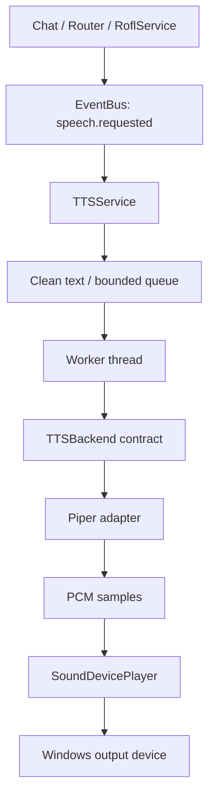

# TTS architecture (text-to-speech / Voice Output)

## Purpose and constraints

TTS is Jarvis's single voice-output boundary. ChatService, Command Router, RoflService, and UI send text/context into it; they do not load models, search audio files, or play sounds directly.

**Piper is the current engine, not a permanent dependency of the architecture.** A future backend implements `TTSBackend` in `voice/tts/engine.py`. The request contract, profile catalog, asset manager, queue, and player must stay independent of engine-specific model types.

STT and TTS remain separate: Whisper/Vosk process microphone input, while TTS converts text to output audio. If a future engine needs heavy/conflicting dependencies, it can run in an isolated environment/process. That is not needed for the current Piper runtime and will be added only if testing justifies it.

## Package layout

The implementation lives under the existing `voice/` package rather than another top-level subsystem:

```text
voice/
├── controller.py                 # existing input/STT orchestration
├── wake_word.py                  # existing wake-word detection
└── tts/
    ├── __init__.py               # stable public API: from voice.tts import ...
    ├── service.py                # queue, worker lifecycle, EventBus and status events
    ├── engine.py                 # TTSBackend protocol
    ├── errors.py                 # TTS-specific exceptions
    ├── models.py                 # VoiceProfile and SpeechRequest contracts
    ├── text.py                   # cleanup and sentence-oriented chunking
    ├── audio_player.py           # output device adapter
    ├── engines/
    │   ├── __init__.py
    │   └── piper.py              # current local Piper backend
    ├── voice_manager.py          # persistent profile catalog
    ├── asset_manager.py          # prepared recordings + bounded audio cache
    └── metrics.py                # queue/synthesis/error counters
```

Existing imports such as `from voice.tts import TTSService, PiperTTSBackend` remain supported. This keeps ChatService, Router, and current tests from depending on internal module paths.

## Runtime path today



Automatic speech remains opt-in. TTS publishes `tts.state_changed` and logs failures, while text chat and Router stay independent. `TTSMetrics` also counts requests, successful syntheses, synthesis time, errors, and queue rejections in memory. Cache/prepared/fallback counters are part of the contract and will become nonzero when the resolver is connected to playback.

## Prepared recordings and cache

`AudioAssetManager` is implemented and independently tested, but it is **not yet wired into live playback**. The next integration change will pass an optional `response_key` through speech requests and resolve them in this order:

1. If a prepared recording exists for `(voice_id, response_key)`, play it.
2. Otherwise, compute a cache key and reuse audio only if the normalized text, voice, engine, model, and synthesis settings all match.
3. Otherwise, synthesize with the active engine, play the audio, and save a cache entry when within the byte budget.
4. If the main route fails, record the failure and use a configured fallback if available. If all voice output fails, preserve the text response and keep the rest of Jarvis working.

Prepared audio is keyed by semantic response IDs, not command-specific file paths inside Router. Example keys: `greeting.hello`, `router.launch.success`, `router.app.not_found`, `router.confirmation`, `rofl.kirill.001`. The source may be recorded by a person or generated by another AI, then imported as a WAV. Changing the active voice should fall back to that voice's TTS/cache until a matching prepared recording exists; it should not rebuild unrelated audio.

### User-data storage

All models, profiles, audio files, and cache entries live in AppData, never in Git or a distributable source archive:

```text
%APPDATA%/Jarvis/tts/
├── voices/                       # installed model/config pairs (existing)
├── voice_profiles.json           # active voice + custom profile metadata
└── assets/
    ├── prepared/                 # stable prepared response WAVs
    ├── cache/                    # disposable generated-audio cache
    └── prepared_manifest.json    # response keys -> managed WAVs
```

AudioAssetManager accepts uncompressed 16-bit PCM WAV (mono/stereo) in v1 and avoids adding another codec dependency. Convert MP3/OGG and other formats before import. The dynamic cache defaults to a 256 MiB limit and evicts least-recently-used files first. Prepared files are not removed during cache pruning.

## Voice profiles and custom voices

A profile stores `voice_id`, display name, engine/model IDs, engine-specific settings, and optional reference audio/transcript metadata. VoiceManager persists profile metadata and active selection locally. This creates the catalog boundary for future multiple voices, preview, and engine-specific cloning support.

Important: attaching a reference sample to a profile does **not** make Piper clone a voice. Piper uses its supported pretrained voices. A prepared recording can use a human voice or audio produced by another AI. Dynamic voice cloning requires an engine that explicitly supports it; reference audio is not uploaded anywhere implicitly.

## State, logging, fallback, and metrics

- TTS reports disabled/missing/ready/downloading/synthesizing/speaking/idle/error states through the existing state event.
- TTS errors are logged/counted and must not cancel ChatService/Router text output.
- The worker queue remains bounded and serialized so two answers do not play at once.
- Metrics include requests, successful syntheses, prepared/cache hits, fallback uses, errors, queue rejections, and accumulated synthesis time.
- The diagnostics/settings UI can display state and snapshots in a later stage; it must never gate text-chat responses on TTS availability.

## Implementation stages

1. **Architecture split (this change):** package the current implementation, retain its public imports, introduce engine/profile/request contracts, and add tested profile, asset, and metrics modules.
2. **Prepared/cache routing:** pass `response_key` through the shared speech event; implement prepared WAV → cache → Piper synthesis → configured fallback and test the end-to-end route.
3. **Voice/settings UI:** populate the voice list from VoiceManager, support importing and previewing recordings, and keep automatic speech off by default.
4. **Diagnostics:** surface service status, cache hit rate, fallback count, queue rejection, and timings in settings/logs.
5. **Engine experiments:** benchmark Piper first on the actual PC; add an alternative adapter later. Add a separate process/environment only if an engine's dependencies or resource usage require it.

This change does not claim prepared files are already selected for playback. The storage/profile components and contracts are ready; the resolver is the next step.

## Licensing and privacy

Piper is distributed under GPL-3.0-or-later. Before bundling it in a redistributed closed-source executable, review the license obligations and distribution model. Check voice-model licensing individually. Profiles, reference audio, downloaded models, prepared recordings, and caches are local user data; the current Piper backend does not call a hosted TTS API.
