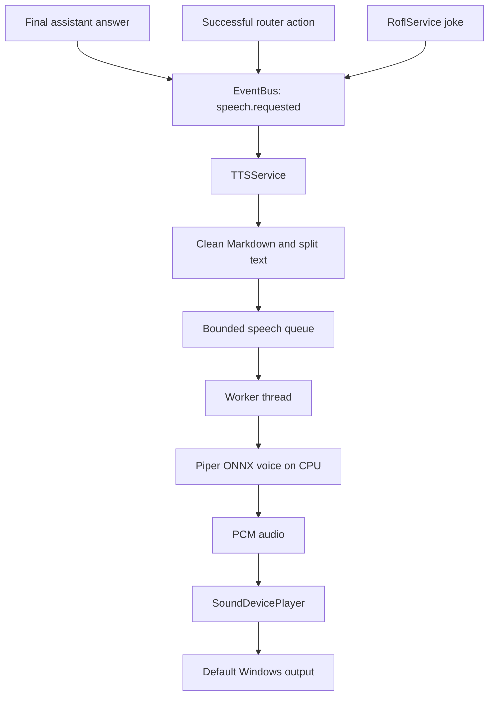

# TTS architecture (text-to-speech)

## Goal

TTS converts the assistant's final text into speech locally. It is a separate output service, not a feature of Whisper, the chat UI or the Command Router. Whisper remains input-only: microphone audio → recognized text. Piper is output-only: text → generated audio.

The first version is deliberately opt-in. It does not speak or download a voice model until the user enables automatic speech and chooses to download a supported voice.

## Request flow

1. A source publishes `speech.requested(text, source)`. Chat and router results publish once at the end of the reply, and RoflService uses the same event for jokes.
2. TTSService ignores empty text, strips common Markdown/code/link noise, limits extremely long responses and puts the request in a bounded queue. A full queue rejects a new line instead of growing memory without a limit.
3. A dedicated worker synthesizes the queued text in short sentence-oriented pieces. The Qt/UI thread never waits for synthesis or playback.
4. Piper returns float PCM samples and sample rate. SoundDevicePlayer plays them, then the worker handles the next fragment/request.
5. Service state is published as `tts.state_changed(state, message)` for settings/status UI. Errors are logged and reported but do not crash chat.

The first implementation speaks after a complete answer arrives; it is **not yet real-time streamed TTS**. Internally the answer is split into smaller chunks so long responses do not have to be synthesized as one large model input. A later streaming implementation can publish sentence-ready events without changing the Piper backend/player contracts.

## Components and ownership

- `voice/tts.py`: text cleanup, chunking, the Piper backend, audio-player interface, bounded queue, state events and shutdown.
- `TTSService`: coordinates requests and lifecycle. Does not import Qt or own any widget.
- `PiperTTSBackend`: lazy-loads Piper only when speech is requested; exposes voice status, voice download, settings and synthesis. The service can later be paired with another backend without changing chat or the UI event contract.
- `SoundDevicePlayer`: the current output adapter. Playback is blocking inside the worker only.
- `SettingsController` / `SettingsPage`: enable/disable automatic speech, choose one of the supported voices, set speed/volume, download the model and play a test phrase.
- `EventBus`: the only coupling between chat/rofl and speech output. No direct calls from chat widgets into the speech engine.

## Voice files and privacy

Voice models are downloaded only after the user presses **Download voice**. They are stored in `APP_DATA_DIR/tts/voices` (on Windows, under the user's application data directory), not in the Git repository, installation archive or application updater backup. Once installed, synthesis runs locally; text is not sent to a hosted TTS API.

The initial voice allow-list is intentionally explicit. Voice files are never downloaded from arbitrary paths or user-supplied URLs. Downloads require HTTPS, enforce a maximum file size, write to a temporary file and validate the model/config pair before reporting success. The first Russian medium voice is roughly 63 MB; the exact download size may vary.

## Wake-word echo prevention

TTS playback can be captured by the microphone and misidentified as the wake phrase. While TTS is synthesizing or speaking, `JarvisApplication` asks `WakeWordDetector` to suppress microphone chunks. The detector drains stale queued audio and resets its recognizer at the suppression boundary, then resumes after playback ends. It does not reload the Vosk model for each phrase.

## Defaults and failure behavior

- Automatic speech defaults to **off**. Text chat remains fully usable without a downloaded voice.
- Missing voice files produce a clear settings status; they are not silently downloaded on startup.
- Voice download, synthesis and output-device failures generate `tts.state_changed("error", message)` and a log entry; they do not take down the application.
- Manual voice preview works while automatic speech is disabled.
- Shutdown cancels pending playback, stops the audio output and unsubscribes the service from `speech.requested`.
- The queue is bounded and playback is serialized, so responses and jokes do not overlap.
- The first version speaks final chat responses and the existing RoflService messages. It intentionally does not read every streaming token, interim transcription, or background progress message.

## Dependency and licensing note

The Python runtime dependency is `piper-tts`; `sounddevice` and `numpy` were already required by the voice-input subsystem and are reused for output. Piper is distributed under GPL-3.0-or-later. Before bundling this runtime into a redistributed closed-source executable, review the license obligations and distribution model. Voice model and training-data licenses are separate and must be checked for each selected voice; do not assume all voices share one license.
